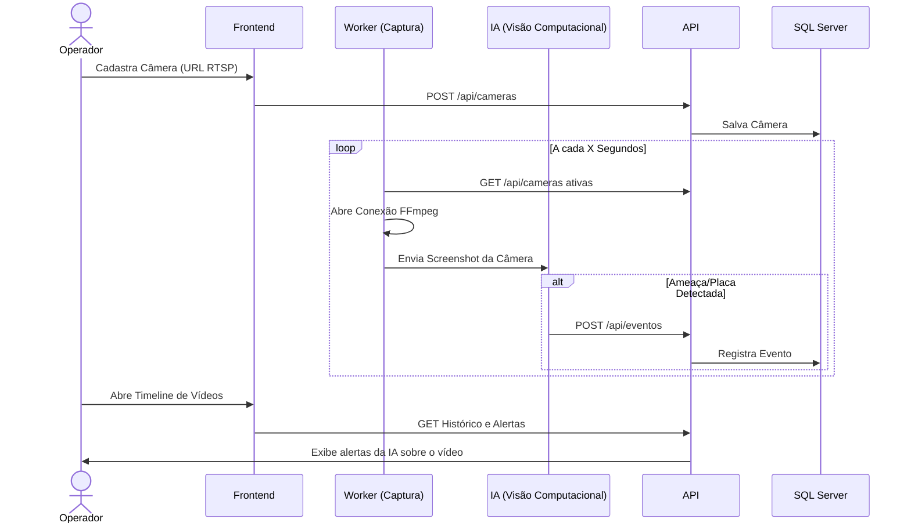
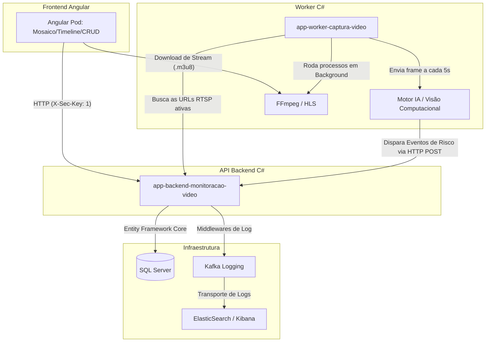

# Documentação Completa: NVR Vision AI (Fluxo Técnico e Funcional)

Este documento centraliza toda a arquitetura desenvolvida ao longo das Fases 1 a 5, detalhando como os dados fluem desde a captura de imagem até a tela do usuário.

## 1. Visão Geral (Fluxo Funcional)
O objetivo do sistema é atuar como um **NVR (Network Video Recorder) Inteligente**. 

1. O **Operador** acessa a tela de Gestão de Câmeras no Frontend e cadastra uma nova câmera de segurança fornecendo um endereço de rede (URL RTSP).
2. Nos bastidores, o **Worker de Captura** descobre essa nova câmera e inicia duas tarefas simultâneas:
   - Grava a transmissão de forma contínua no disco rígido fatiando em vídeos `.mp4` a cada 15 minutos.
   - Puxa 1 foto (screenshot) da câmera a cada 5 segundos e envia para o Motor de Inteligência Artificial.
3. A **Inteligência Artificial** (Visão Computacional) analisa a foto. Se detectar uma Placa de Carro (LPR) ou a presença de uma Pessoa, ela dispara um "Evento" de alerta para o banco de dados via API.
4. O **Operador** pode abrir o "Mosaico" para assistir as câmeras ao vivo em tempo real ou abrir a "Timeline" para rever os vídeos gravados e visualizar os pontos exatos onde a IA disparou alertas.

### 1.1. Diagrama do Fluxo Funcional (Sequência)

---

## 2. Visão Arquitetural (Fluxo Técnico)
O ecossistema é baseado em Microserviços e foi integrado à rede corporativa existente (`shopping-network`).

### 2.1. Componentes do Sistema
- **Frontend (Angular 18+)**: Segue o padrão de Micro-frontends (Pods), escrito em TypeScript estrito, com design system em Glassmorphism. O `hls.js` foi embarcado nativamente para transcodificar e exibir o feed RTSP diretamente no navegador.
- **Backend API (.NET 8/9)**: Construído em Clean Architecture (API, Domain, Infrastructure). Expõe os endpoints REST (`/api/cameras`, `/api/eventos`, `/api/gravacoes`) e é o único detentor do `MonitoracaoVideoDbContext` (Acesso ao SQL Server).
- **Worker Service (.NET)**: Um projeto Headless que roda em *BackgroundService*. Utiliza a classe `Process` do C# para interagir com os binários executáveis do **FFmpeg** nativo do servidor operacional, permitindo gravação em hardware.
- **Infraestrutura**: Aproveita o SQL Server compartilhado e propaga toda a rastreabilidade via `KafkaLoggingMiddleware` para o ELK Stack (Elasticsearch + Kibana).

### 2.2. O Segredo da Transmissão (RTSP para HLS)
Navegadores não entendem o protocolo RTSP de câmeras IP. O nosso Worker possui um `StreamManager` que usa o FFmpeg para converter a transmissão da câmera "On-the-fly" para o formato Apple HLS (pedaços curtos de `.ts` anexados em um índice `.m3u8`).
O Frontend angular, via `hls.js`, consome esse índice e costura os vídeos dando a impressão de um player ao vivo tradicional.
